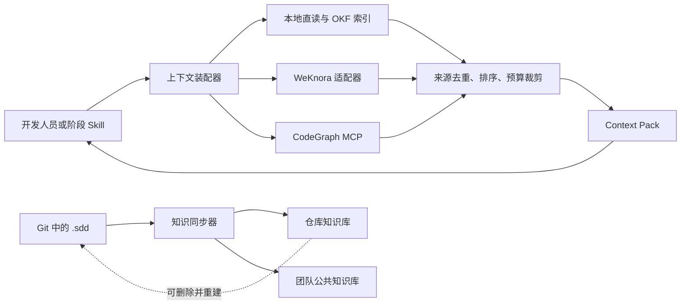

# IDF-SDD 知识治理、检索与上下文工程改造设计

> 文档状态：待实施
>
> 设计基线：IDF-SDD v1.2.0，Git 提交 `a8c3518`
>
> 目标范围：Claude Code 插件；暂不包含 Multica 小队适配
>
> 编写日期：2026-08-17
>
> 目标读者：负责改造 IDF-SDD 的开发者或编码智能体

## 1. 执行摘要

本次改造不是单纯新增一个搜索命令，而是把 IDF-SDD 从“能驱动五阶段开发流程的插件”升级为“以 Git 为事实源、以 WeKnora 为团队检索层、以 CodeGraph 为当前代码结构层的轻量软件设计开发知识系统”。

改造后保留现有五个阶段，不增加开发人员必须理解的流程复杂度：

1. `/sdd:define`：需求定义；
2. `/sdd:plan`：技术规划；
3. `/sdd:build`：编码实现；
4. `/sdd:verify`：验证审查；
5. `/sdd:ship`：准备交付与完成归档。

同时保留三个辅助入口：

- `/sdd:init`：一次性初始化项目知识底座，生成项目地图与项目规则，建立 CodeGraph，绑定 WeKnora；
- `/sdd:search`：按问题类型自动选择本地直读、WeKnora、CodeGraph，返回带来源的知识上下文；
- `/sdd:status`：显示流程状态、基础设施状态和知识同步状态。

核心原则如下：

- `.sdd/` 中的 Markdown 文档与代码一起提交，是唯一权威知识源；
- WeKnora 只保存可重建的检索副本，不反向覆盖 Git 文档；
- CodeGraph 只回答“当前代码是什么、调用关系是什么、改动影响什么”；
- `repository.md` 和 `policy.md` 在每个阶段直接读取，不先做语义检索；
- 简单需求使用 `lite` 模式压缩每个阶段的深度，但不绕过阶段和关键验收；
- 知识消费必须按需、限量、可追溯，不能把所有历史文档一次性塞入模型上下文；
- WeKnora 故障不能破坏 Git 中的开发事实，也不应阻断软件交付，失败同步进入可重试状态；
- 面向开发人员只新增一个常用命令 `/sdd:search`，同步、索引和路由尽量自动完成。

## 2. 背景与问题

### 2.1 当前已经解决的问题

IDF-SDD v1.2.0 已经具备以下基础能力：

- `init + define + plan + build + verify + ship` 的完整流程；
- `lite / standard / strict` 三种执行模式；
- 由 `spec.md` Frontmatter 驱动的状态机；
- 需求、方案、验证和交付四类归档文档；
- 基于验证指纹的交付门禁；
- 指定使用 `colbymchenry/codegraph` 的本地代码图谱；
- 中文 Skill、模板、README 和参考文档；
- 对社区 Skill 思想与来源的公开说明。

### 2.2 当前未解决的问题

现有实现仍然更像“流程执行器”，尚未成为可长期消费的知识系统：

- `.sdd/changes/` 中的历史文档只有目录结构，没有统一、可查询的知识元数据；
- 没有 OKF 根索引和分层索引，模型只能遍历目录或猜测文件；
- 没有 `/sdd:search`，不能统一处理精确查找、语义检索和代码影响分析；
- 没有 WeKnora 连接、上传、更新、ID 映射、失败重试和本地缓存；
- 当前 `policy.md` 是插件复制的固定模板，不会根据业务仓库的 CI、测试、Lint、架构约束生成项目规则；
- `repository.md` 虽然由 `/sdd:init` 填充，但缺少稳定的刷新与漂移治理规则；
- 各阶段没有明确规定什么时候消费哪些历史知识，以及最多把多少内容放进上下文；
- 没有检索质量基准，无法证明“混合检索精度够不够”；
- 没有知识同步状态，无法知道某次完成的需求是否已经进入团队知识库。

### 2.3 当前 `policy.md` 的真实生成机制

当前版本并没有使用大模型提示生成项目 `policy.md`。`plugins/sdd/scripts/sdd.mjs` 的初始化逻辑只在文件不存在时复制静态模板，等价行为为：

```javascript
if (!fs.existsSync(policyFile)) {
  copyTemplate('policy.md', policyFile);
}
```

当前 `/sdd:init` Skill 会读取已有 `policy.md` 并保留人工修改，但没有扫描 CI、测试、Lint、架构文档后提炼项目规则的提示和确定性模块。与之不同，`repository.md` 会由 init Skill 根据仓库证据和 CodeGraph 结果替换模板占位符。

因此本次不是“小修现有 policy 生成提示”，而是新增完整的项目规则发现、证据约束、差异确认和安全更新机制，详见第 10 节。

## 3. 目标、非目标与设计约束

### 3.1 目标

本次改造必须实现：

1. 让每个完成的需求都留下可理解、可追溯、可检索的设计依据；
2. 让新的开发会话能在极少上下文中理解项目边界、工程规则和当前任务；
3. 让历史需求、方案、事故与交付决策可以跨会话、跨人员、按需复用；
4. 让自然语言问题与代码符号问题走不同检索通道，并能合并结果；
5. 让本地精确读取尽可能即时，远程检索原始结果 P95 在 5 秒内返回；
6. 让 WeKnora 随时可以从 Git 中的 `.sdd/` 重建，不形成供应商锁定；
7. 让实现者可以根据本文档直接完成代码、模板、Skill、测试和文档改造。

### 3.2 非目标

本次不实现：

- Multica 小队、Agent 编排或 Skill 移植；
- 用 WeKnora 替代 Git、代码评审或业务仓库权限；
- 把业务源码全文上传到 WeKnora；
- 自研向量数据库、Embedding 服务或 Rerank 模型；
- 自动生成并反向修改业务代码的架构 Wiki；
- 依靠一个“万能 Agent”编排所有角色；
- 强迫简单字段变更产出与大型架构改造同等篇幅的文档。

### 3.3 已确认的部署假设

实现时按以下默认假设设计，但所有环境相关值必须可配置，不能硬编码：

- 团队有一套统一部署的 WeKnora；
- 每个业务仓库对应一个独立知识库；
- 团队公共规范使用一个独立知识库，逻辑名称默认为 `IDF-Shared`；
- WeKnora 地址和 API Key 通过环境变量提供，不提交到 Git；
- WeKnora 的实际版本、租户、空间、知识库 ID 在不同环境可能不同；
- CodeGraph 是 `https://github.com/colbymchenry/codegraph`；
- `.codegraph/` 和运行缓存只保存在本地，不提交；
- `.sdd/` 与业务代码一起提交和评审。

### 3.4 社区能力复用边界

现有 README 已明确说明对 `addyosmani/agent-skills`、`obra/superpowers` 和 `mattpocock/skills` 的方法复用。本次改造必须保留这一说明和现有五阶段实践，不把三个上游仓库变成运行时依赖：

- 上游提供经过社区验证的方法、检查清单和思考框架；
- IDF-SDD 负责统一命令、状态机、中文交互、文档契约、权限边界和知识治理；
- 本次新增的 OKF、WeKnora、检索路由、同步清单和项目规则治理属于 IDF-SDD 的集成设计；
- 上游版本变化不能静默改变团队流程，任何吸收都要经过评估、适配、测试和 README 归因更新；
- 实施者不得为了接入知识管理而删减现有的分级澄清、TDD、系统化调试、双轴评审、交付证据和动作级授权规则。

## 4. 总体架构

### 4.1 三层知识事实模型

| 层 | 回答的问题 | 权威性 | 持久化位置 | 典型消费方式 |
| --- | --- | --- | --- | --- |
| Git / OKF 知识层 | 为什么做、当时怎么设计、验证过什么、项目必须遵守什么 | 唯一权威 | `.sdd/**/*.md` | 精确直读、代码评审、审计、WeKnora 重建 |
| WeKnora 检索层 | 历史上是否做过类似事情、有哪些相关决策、跨项目有什么经验 | 派生索引 | 团队 WeKnora | 混合检索、跨项目检索、相似知识发现 |
| CodeGraph 代码层 | 当前类/函数/调用链是什么、改动会影响哪里 | 当前代码权威视图 | 本地 `.codegraph/` | 符号搜索、调用分析、影响分析 |

三层不能互相替代。尤其要避免以下错误：

- 从 WeKnora 中检索到的旧方案不能覆盖当前仓库事实；
- 交付文档里记录的旧代码位置不能替代 CodeGraph 的当前调用关系；
- CodeGraph 能描述代码结构，但不能回答当时为什么选择该实现；
- WeKnora Wiki 可以作为派生导航页，但不能自动回写 `.sdd/`。

### 4.2 运行关系



### 4.3 用户可见命令与内部组件

开发人员仍然只需要理解五阶段命令和少量辅助命令。内部复杂性封装在插件中：

| 用户入口 | 主要职责 | 内部能力 |
| --- | --- | --- |
| `/sdd:init` | 初始化或刷新项目知识底座 | 项目探测、CodeGraph、规则生成、OKF 索引、WeKnora 绑定 |
| `/sdd:define` | 定义需求 | 本地基础上下文、历史相似需求检索、范围澄清 |
| `/sdd:plan` | 技术规划 | 历史方案检索、当前代码影响分析、任务分解 |
| `/sdd:build` | 实现 | 精确读取当前规格和方案，遇到问题时按需检索 |
| `/sdd:verify` | 验证 | 验收映射、历史回归风险、代码影响复核 |
| `/sdd:ship` | 交付和归档 | 交付文档、项目知识漂移检查、DONE 后同步 |
| `/sdd:search` | 主动查知识 | 查询分类、路由、并行搜索、Context Pack |
| `/sdd:status` | 查看状态 | 流程状态、CodeGraph 状态、WeKnora 绑定和同步状态 |

## 5. 流程与状态机

### 5.1 状态机保持不变

现有状态机继续作为流程真相：

```text
DRAFT → DEFINED → PLANNED → BUILT → VERIFIED → IN_REVIEW → DONE
```

允许的返工路径继续保留：

- `BUILT → PLANNED`：实现发现方案不可行；
- `IN_REVIEW → PLANNED`：评审要求重新设计；
- `PLANNED → DRAFT`：需求边界需要重开。

`spec.md` 的 `state` 仍是工作流状态权威。OKF 的 `status` 是可选字段，只在知识被废弃或替代时写入，不为正常文档重复填写 `status: active`：

- `state`：本次变更在 SDD 流程中的阶段；
- `status`：知识文档本身是否仍有效，例如 `superseded`、`deprecated`；缺省即表示当前有效。

### 5.2 模式保持不变

| 模式 | 适用情形 | 文档深度 | 强制规则 |
| --- | --- | --- | --- |
| `lite` | 字段、条件分支、小范围配置或局部修复 | 每份文档可很短 | 仍需明确验收、执行验证、形成交付记录 |
| `standard` | 常规功能、多个文件、局部接口变化 | 标准深度 | 默认模式 |
| `strict` | 架构、数据、安全、跨系统、高风险改造 | 详细方案与证据 | 增强评审和回滚要求 |

模式只控制每个阶段的深度，不允许删除阶段。模型判断模式后必须让用户确认；用户也可显式指定。

### 5.3 知识同步时点

| 状态 | Git 文档 | WeKnora 行为 |
| --- | --- | --- |
| DRAFT / DEFINED / PLANNED | 正常提交或保存在分支 | 不上传，避免草案污染团队知识 |
| BUILT / VERIFIED / IN_REVIEW | 本地可检索 | 默认不上传；仅显式预览模式允许临时同步 |
| DONE | 已评审、已接受 | 自动发布为正式知识 |

正式同步触发点是 `/sdd:ship --complete` 成功把状态推进到 `DONE` 之后。同步失败不得把状态回滚；应记录 `pending`，在 `/sdd:status` 中明确提示，并在下次 `init --refresh`、`ship --complete` 或 CI 同步任务中重试。

原因是 Git 才是事实源，WeKnora 是最终一致的派生索引。远程检索服务故障不应阻止软件本身完成交付。

同步执行位置支持两种配置，但业务语义相同：

- `local`：开发机在 `ship --complete` 后直接同步，适合开发人员拥有仓库知识库写权限的团队；
- `ci`：`ship --complete` 只标记文档为“可发布”，由合并后的 CI 使用受控写凭据执行同一个 `knowledge sync` 子命令，适合严格权限环境。

默认可先使用 `local`，但实现必须支持切换到 `ci`，不能把开发机持有写 Key 当成架构前提。

## 6. 目录与文件设计

### 6.1 目标业务仓库结构

```text
.sdd/
├── index.md                         # OKF 根索引，提交 Git
├── repository.yaml                 # 插件机器配置，不是知识元数据
├── repository.md                   # 项目短地图，提交 Git
├── policy.md                       # 团队基线 + 项目规则，提交 Git
└── changes/
    ├── index.md                     # 变更索引，提交 Git
    └── <change-id>/
        ├── spec.md                  # 为什么做、做什么
        ├── plan.md                  # 怎么做、为何这么选
        ├── verification.md          # 如何证明做对了
        └── delivery.md              # 最终实际交付与偏差

.sdd-cache/                          # 全部忽略，不提交 Git
├── local-index.json                 # 本地快速索引
├── weknora-manifest.json            # document_key 到远端 ID 的映射
├── capabilities.json                # WeKnora/CodeGraph 能力探测结果
└── locks/                            # 并发同步锁

.codegraph/                           # CodeGraph 本地索引，忽略
```

必须把 `.sdd-cache/` 和 `.codegraph/` 加入业务仓库 `.gitignore`。不得把 API Key、实际访问令牌或包含私有服务凭据的响应写入 `.sdd/`。

### 6.2 为什么保留 `repository.yaml`

用户要求元数据符合 OKF，不意味着仓库里不能存在 YAML 配置。两类内容必须区分：

- 知识元数据：写在每个 Markdown 文件顶部的 YAML Frontmatter 中；
- 插件机器配置：继续放在 `.sdd/repository.yaml`，供脚本读取。

禁止再创建 `spec.metadata.yaml`、`delivery.metadata.yaml` 等旁路元数据文件。

### 6.3 OKF 索引

`.sdd/index.md` 是渐进式入口，只列出项目级知识和 `changes/index.md`，不展开所有变更正文。`.sdd/changes/index.md` 由脚本根据本地文档确定性生成，至少包含：

- change ID；
- 标题；
- 当前状态；
- 模式；
- capability；
- components；
- 更新时间；
- 指向四类文档的相对链接。

索引文件必须可重建；禁止让模型手工维护大量重复表格。

## 7. OKF 文档契约

### 7.1 兼容策略

本设计遵循 OKF v0.2 的最低互操作要求：知识以目录中的 Markdown 表达，文档包含 YAML Frontmatter，`type` 非空，允许增加自定义字段，并通过普通 Markdown 链接形成关系。

为避免破坏 v1.2.0 状态机，本次采用“增量兼容”而非大规模字段搬迁：

- 保留现有顶层 `id`、`state`、`mode`、`title` 等工作流字段；
- 只强制新增 OKF 必需的 `type`；
- 只增加 `capability`、`components` 两个真正有检索价值的业务字段；
- `description`、`tags` 仅在能提供额外信息时选填，不能重复标题和组件；
- `status` 仅在文档被替代或废弃时出现；
- `repo`、文档类别、路径、Git SHA、时间、验证状态和稳定键均由程序推导，不写入文档；
- 不增加 `sdd` 嵌套命名空间，避免同一信息重复两遍。

### 7.2 通用 Frontmatter

变更类文档沿用现有工作流字段，只补充少量检索字段。以 `spec.md` 为例：

```yaml
---
type: sdd-spec
id: add-channel-filter
title: 订单查询增加渠道筛选
state: DONE
mode: lite
capability: order-query
components: [order-api, order-domain]
---
```

这段 Frontmatter 只保留作者需要确认的信息。下列信息由同步器在运行时补充，禁止让模型或开发人员手工维护：

| 派生信息 | 来源 |
| --- | --- |
| `repo` | `.sdd/repository.yaml` |
| `artifact_type` | `type` 和文件名 |
| `source_path` | 当前文件路径 |
| `document_key` | `repo + id + type` 确定性生成 |
| `git_sha`、时间 | Git 与文件系统 |
| `verified_at` | `verification.md` 和状态迁移记录 |

注意：Frontmatter 是 Markdown 文档的一部分，不是独立 YAML 元数据文件。OKF v0.2 的 `sources`、`generated`、`verified` 等信任字段仍可扩展，但 IDF-SDD 默认不要求，以免增加日常维护负担；出处和验证证据写在文档正文中即可。

`repository.md`、`policy.md` 和索引文件没有 change 状态，只需 `type`、`title`。`description`、`tags` 只在确有额外检索价值时增加；不得为了让所有文件长得一样而填充无意义的空字段。

### 7.3 文档类型

| 文件 | `type` | 程序生成的 `document_key` |
| --- | --- | --- |
| `.sdd/index.md` | `sdd-index` | `<repo>:index` |
| `.sdd/repository.md` | `repository-map` | `<repo>:repository` |
| `.sdd/policy.md` | `repository-policy` | `<repo>:policy` |
| `spec.md` | `sdd-spec` | `<repo>:<change-id>:spec` |
| `plan.md` | `sdd-plan` | `<repo>:<change-id>:plan` |
| `verification.md` | `sdd-verification` | `<repo>:<change-id>:verification` |
| `delivery.md` | `sdd-delivery` | `<repo>:<change-id>:delivery` |

`document_key` 是 IDF-SDD 生成的稳定逻辑主键，不是 WeKnora 的 `knowledge_id`。即使远端文档被删除重传，`document_key` 也不变。

### 7.4 WeKnora 元数据扁平化

WeKnora 文件上传接口的 `metadata` 是 JSON 字符串，服务端按 `map[string]string` 处理。因此上传值应转换为：

```json
{
  "okf_type": "sdd-spec",
  "sdd_repo": "order-service",
  "sdd_change_id": "add-channel-filter",
  "sdd_capability": "order-query",
  "sdd_components": "order-api,order-domain",
  "sdd_source_path": ".sdd/changes/add-channel-filter/spec.md",
  "sdd_document_key": "order-service:add-channel-filter:spec"
}
```

这些上传元数据全部由程序从短 Frontmatter、仓库配置和文件路径生成，用户不填写。数组按去重、排序后的逗号连接字符串上传；字段名和序列化规则必须有单元测试，不能散落在各个 Skill 中。

## 8. 四类变更交付件

### 8.1 `spec.md`：需求事实

必须回答：

- 背景和业务问题是什么；
- 目标与非目标是什么；
- 用户或调用方如何使用；
- 范围内和范围外分别是什么；
- 验收标准是什么；
- 有哪些限制、假设和未决问题；
- 本次变更涉及哪些 capability 和 components。

`spec.md` 不写具体实现步骤。验收标准必须可验证，后续 `verification.md` 要逐条映射。

### 8.2 `plan.md`：技术决策

必须回答：

- 当前代码结构与入口；
- 候选方案及取舍；
- 最终方案为何适合；
- 文件、模块、接口和数据如何改变；
- 测试、迁移、兼容、安全和回滚策略；
- 可执行的任务分解；
- CodeGraph 影响分析结果与来源。

计划记录的是“打算怎么做”。如果实现发生偏差，不回头伪造原计划，而是在 `delivery.md` 记录差异和原因。

### 8.3 `verification.md`：验证证据

必须回答：

- 每条验收标准由什么证据证明；
- 执行了哪些测试、静态检查、构建和人工检查；
- 命令、结果、时间和环境是什么；
- 哪些未执行，为什么未执行，风险如何接受；
- CodeGraph 影响范围是否与方案一致；
- 验证指纹对应哪个 Git 工作树状态。

禁止只写“测试通过”。证据要能让下一个开发者判断覆盖了什么、没有覆盖什么。

### 8.4 `delivery.md`：最终实际事实

必须回答：

- 最终交付了什么；
- 最终修改了哪些组件、关键文件和接口；
- 实现与原计划有哪些偏差，为什么；
- 最终测试和验证摘要；
- 发布、迁移、观测和回滚方式；
- 已知限制与后续事项；
- 为什么代码最终呈现为当前形态；
- 对 `repository.md` 和 `policy.md` 是否产生长期影响。

`delivery.md` 是历史检索中最优先的“已实施事实”。查询“以前这个功能为什么这么写”时，默认优先返回 `delivery.md`，然后补充 `plan.md` 和 `spec.md`。

## 9. `repository.md` 设计

### 9.1 定位

`repository.md` 是给人和模型都能快速阅读的“项目短地图”，不是完整架构文档，也不是代码清单。每个阶段启动时都直接读取，不经过 WeKnora。

建议控制在 100～200 行、10～15 KB 以内。超过阈值只警告，不阻断；持续超长应重构为短地图加链接，而不是继续堆内容。

### 9.2 必备内容

1. 项目职责和明确非职责；
2. 核心技术栈和运行形态；
3. 顶层模块及职责边界；
4. 关键入口，例如 HTTP、消息、定时任务、CLI；
5. 核心领域术语；
6. 外部系统和数据依赖；
7. 构建、测试、Lint、启动命令摘要；
8. 测试目录和主要测试层级；
9. 全局工程约束摘要，并链接到 `policy.md`；
10. 安全、合规、数据等敏感区域；
11. 重要架构文档、规范和变更记录链接；
12. 最近一次生成/确认的证据来源。

不得写入：

- 完整目录树；
- 所有类、函数或接口列表；
- 很快过期的临时实现细节；
- 可以由 CodeGraph 即时获得的调用链；
- 未经证据支持的推断。

### 9.3 生成与更新

`/sdd:init` 首次生成时必须读取可执行配置、主要入口、现有说明文档，并使用 CodeGraph 做聚焦探索。模型只根据证据替换模板占位符。

`/sdd:init --refresh` 用于主动刷新。`/sdd:ship` 只做漂移检查：如果本次变更改变了以下内容，提出最小差异并等待确认后更新：

- 顶层模块或职责边界；
- 关键入口；
- 主要外部依赖；
- 构建、测试或启动方式；
- 全局架构约束；
- 敏感数据或安全边界。

增加字段、增加一个 `if`、内部重构、普通 Bug 修复默认不更新 `repository.md`。任何命令都不得静默整份重写人工维护的内容。

## 10. `policy.md` 设计与生成提示

### 10.1 定位

`policy.md` 回答“在这个业务仓库开发时必须遵守什么”。它既包含 IDF 团队统一规则，也包含从本项目证据中发现的工程规则，例如：

- UT 的位置、命名、Fixture、Mock 和断言习惯；
- 哪些改动必须有单元、集成或 E2E 测试；
- 构建、Lint、格式化、类型检查命令；
- 分层依赖、模块边界和禁止依赖；
- 数据库迁移、消息兼容、API 兼容规则；
- 日志、错误处理、敏感信息和权限规则；
- 哪些动作可直接执行、哪些必须先询问、哪些绝不能执行。

每个阶段同样直接读取 `policy.md`，不先查询 WeKnora。

### 10.2 文件分区

为避免插件更新和项目规则互相覆盖，文件使用受控边界：

```markdown
<!-- idf-sdd:team-baseline:start -->
## 团队统一规则
...
<!-- idf-sdd:team-baseline:end -->

<!-- idf-sdd:project-policy:start -->
## 项目工程规则
...
<!-- idf-sdd:project-policy:end -->

<!-- idf-sdd:human-overrides:start -->
## 团队确认与例外
...
<!-- idf-sdd:human-overrides:end -->
```

- 团队基线由插件模板提供，升级时按版本做受控迁移；
- 项目规则由 `/sdd:init` 或 `--refresh` 提议更新；
- 人工确认和例外区永不被模型自动重写；
- 刷新时展示最小 diff，确认后才落盘；
- 规则变化走普通 Git 评审。

### 10.3 证据优先级

生成项目规则时按以下顺序取证：

1. CI、构建、测试、Lint、格式化、依赖和部署的可执行配置；
2. `AGENTS.md`、`CLAUDE.md`、`CONTRIBUTING.md` 等显式指令；
3. 测试、架构、数据库、安全和运维文档；
4. 代码库中重复出现的稳定模式；
5. 单个代码示例只能作为线索，不能直接提升为规则。

禁止模型凭经验发明覆盖率阈值、命名规则、框架习惯或安全要求。证据不足的候选规则进入“待团队确认”，不能写成强制规则。

### 10.4 `/sdd:init` 使用的项目规则生成提示

实现者应将下面的语义固化为 `policy-discovery` 模块或 Skill，不要把提示逻辑散落在命令说明中：

```text
你是 IDF-SDD 项目规则审计器。你的任务不是发明最佳实践，而是从当前仓库中提取已经存在、可执行、可验证的工程约束。

输入：
1. IDF-SDD 团队基线；
2. 仓库根目录与主要配置文件清单；
3. CI、构建、测试、Lint、格式化和部署配置内容；
4. AGENTS.md、CLAUDE.md、CONTRIBUTING.md 及项目文档；
5. CodeGraph 返回的测试布局、模块边界和关键入口；
6. 现有 policy.md 的项目规则区与人工例外区。

要求：
- 只输出有证据支持的规则；
- 每条规则标记为“必须”“先询问”或“禁止”；
- 每条规则附来源文件、配置项或至少两个重复代码证据；
- 明确写出适用范围和触发条件；
- 不从单个示例推导全局规则；
- 不发明覆盖率、命名、分层或安全要求；
- 证据冲突时列出冲突，放入“待团队确认”；
- 保留人工例外，不降低更严格的显式规则；
- 输出新的项目规则区和相对旧版本的最小变更摘要。

输出结构：
1. 命令与质量门禁；
2. 测试规则；
3. 代码与架构边界；
4. 数据、接口与消息兼容；
5. 安全、日志与敏感信息；
6. 必须先询问的操作；
7. 禁止操作；
8. 待团队确认；
9. 证据索引；
10. 变更摘要。
```

### 10.5 更新规则

`policy.md` 只在以下情况更新：

- 团队基线版本升级；
- CI、测试、构建或发布流程变化；
- 编码、架构、安全、数据或兼容性规范变化；
- 团队确认了一个原先未决的规则或例外。

普通业务需求不会自动修改 `policy.md`。`/sdd:verify` 和 `/sdd:ship` 检查是否遵守规则，但不能为让检查通过而改写规则。

## 11. WeKnora 集成设计

### 11.1 知识库划分

默认采用：

- 一个业务仓库对应一个 WeKnora 知识库；
- 一个团队公共知识库 `IDF-Shared` 存放统一规范、共享架构和跨项目经验；
- 当前项目查询默认限定“当前仓库知识库 + IDF-Shared”；
- 只有 `/sdd:search --all` 或明确跨项目意图才扩展到更多业务知识库。

这样既避免把所有项目混在一个库里导致召回噪声，也保留跨项目复用能力。

### 11.2 配置契约

在 `.sdd/repository.yaml` 增加逻辑配置，不保存服务器生成的 ID：

```yaml
knowledge:
  provider: weknora
  enabled: true
  base_url_env: WEKNORA_HOST
  api_key_env: WEKNORA_API_KEY
  repository_kb_name: idf-sdd/order-service
  shared_kb_names:
    - IDF-Shared
  sync_on: DONE
  sync_executor: local
  search_timeout_ms: 3500
  overall_timeout_ms: 5000
  direct_read_max_documents: 5
  direct_read_max_bytes: 40960
  required_on_done: false
```

`repository_kb_name` 是可提交的逻辑名称；实际 `knowledge_base_id` 由当前 WeKnora 环境解析，并放入 `.sdd-cache/weknora-manifest.json`。换一台机器或换一个 WeKnora 环境时可以重新绑定。

绑定算法必须确定且可诊断：

1. 调用知识库列表接口，在当前租户/空间按逻辑名称做精确匹配；
2. 只命中一个：复用并缓存其 ID；
3. 未命中且调用方有创建权限：按默认文档型知识库配置创建；
4. 未命中且无创建权限：停止绑定并提示管理员预建的准确名称；
5. 同名命中多个：拒绝猜测，输出候选 ID、空间和负责人信息；
6. 把逻辑名称、实际 ID、环境指纹和探测时间写入本地 manifest；
7. 后续请求如果出现 404/403 或环境指纹变化，废弃缓存并重新绑定。

### 11.3 API 适配层

插件必须封装 `WeKnoraClient`，Skill 不得直接拼 REST 路径。适配层至少提供：

```text
probeCapabilities()
resolveKnowledgeBase(logicalName)
createKnowledgeBase(logicalName, options)
listKnowledge(kbId, page)
uploadMarkdownFile(kbId, path, metadata)
getKnowledge(knowledgeId)
deleteKnowledge(knowledgeId)
search(request)
hybridSearch(request)       # 可选调优接口
waitUntilParsed(knowledgeId, deadline)
```

生产默认检索使用不调用 LLM 的 `POST /api/v1/knowledge-search`，因为它可限定 `knowledge_base_ids`、`knowledge_ids` 并直接返回排序后的知识块。低层 `POST /api/v1/knowledge-bases/:id/hybrid-search` 只用于部署支持时的调参、诊断或更细粒度控制。

默认请求契约示例：

```json
{
  "query": "以前订单查询为什么没有直接联表？",
  "knowledge_base_ids": ["kb-order-service", "kb-idf-shared"],
  "knowledge_ids": ["knowledge-001", "knowledge-002"]
}
```

`knowledge_ids` 是可选的：本地候选很多但范围已知时传入；完全开放的语义检索不传。响应中的 `data[]` 是块级结果，适配层至少保留 `content`、`knowledge_id`、`knowledge_title`、`chunk_index`、`score`、`metadata` 和来源文件信息。`score` 是检索/重排后的最终相关度信号，只用于同一次查询内排序，不能跨不同部署或模型当作绝对质量分数。

上传使用 `POST /api/v1/knowledge-bases/:id/knowledge/file`，表单包含 `file`、`fileName` 和序列化后的 `metadata`。上传响应中的 `data.id` 才是 `knowledge_id`。

WeKnora API 可能随团队部署版本变化，所以 `/sdd:init` 必须做能力探测并缓存结果。版本不兼容时输出精确的缺失能力和建议，不允许假装同步成功。

### 11.4 为什么不能从本地元数据得到 `knowledge_id`

本地元数据只能得到候选文档的逻辑主键和属性，例如：

```text
repo = order-service
component = order-query
artifact_type = delivery
state = DONE
document_key = order-service:add-channel-filter:delivery
```

这些信息能帮助判断“应该搜索哪些文档”，但不能推导 WeKnora 的 UUID。首次上传后才会得到：

```text
document_key order-service:add-channel-filter:delivery
    → WeKnora 响应 data.id
    → knowledge_id 4c4e7c1a-09cf-485b-a7b5-24b8cdc5acf5
```

该映射保存在本地同步清单。新机器没有清单时，通过列出知识库文档、读取远端 `metadata.sdd_document_key` 重建，而不是重新计算或把环境 ID 提交到 Git。

### 11.5 同步清单

`.sdd-cache/weknora-manifest.json` 最少包含：

```json
{
  "schemaVersion": 1,
  "environmentFingerprint": "sha256(baseUrl+tenant)",
  "knowledgeBases": {
    "idf-sdd/order-service": "kb-00000001",
    "IDF-Shared": "kb-00000002"
  },
  "documents": {
    "order-service:add-channel-filter:delivery": {
      "sourcePath": ".sdd/changes/add-channel-filter/delivery.md",
      "contentHash": "sha256:...",
      "knowledgeBaseId": "kb-00000001",
      "knowledgeId": "4c4e7c1a-09cf-485b-a7b5-24b8cdc5acf5",
      "parseStatus": "completed",
      "syncStatus": "synced",
      "syncedAt": "2026-08-17T18:20:00+08:00",
      "lastError": null
    }
  }
}
```

`environmentFingerprint` 只用于防止把 A 环境的远端 ID 误用到 B 环境，不能包含明文密钥。

### 11.6 幂等同步算法

同步每个文档时执行：

1. 解析并校验 OKF Frontmatter；
2. 计算规范化内容哈希；
3. 用 `document_key` 查本地清单；
4. 哈希相同且远端状态有效：跳过；
5. 无映射：上传，保存返回的 `knowledge_id`，轮询解析状态；
6. 有映射但内容变化：
   - 部署支持原内容替换/Upsert 时使用该能力；
   - 否则先上传新版本并等待解析完成，再删除旧版本，最后原子替换清单映射；
   - 新版本失败时保留旧版本，避免知识中断；
7. 记录状态为 `synced`、`pending` 或 `failed`；
8. 不论成功失败，都不得修改源 Markdown 内容。

变更目录在 DONE 后原则上不可随意修改，因此绝大多数变更文档只上传一次。`repository.md` 和 `policy.md` 会随项目演进更新，必须支持替换流程。

## 12. 本地索引设计

### 12.1 目的

本地索引不是另一个搜索引擎，而是为以下操作提供毫秒级候选筛选：

- change ID、标题、类型和路径精确查找；
- 按 capability、component、state、mode、tag 过滤；
- 判断候选文档数量和总字节数；
- 从 `document_key` 找到 WeKnora `knowledge_id`；
- 判断哪些文档待同步。

### 12.2 数据来源与刷新

`.sdd-cache/local-index.json` 只能从 `.sdd/**/*.md` 重建。以下事件触发增量或全量刷新：

- `/sdd:init` 和 `/sdd:init --refresh`；
- 创建变更；
- 状态迁移；
- 生成或更新四类交付件；
- `/sdd:search` 发现索引不存在、版本不兼容或源文件 mtime/hash 改变；
- `/sdd:status` 可做快速一致性检查。

建议索引记录 `path`、`document_key`、公共元数据、字节数、mtime、内容哈希和远端 ID，不保存完整正文。正文仍从源文件读取。

### 12.3 直读阈值

默认满足以下两个条件时直接读取源 Markdown，不调用 WeKnora：

- 候选文档数不超过 5；
- 候选总大小不超过 40 KB。

这样解决“既然已经筛出几个文档，为什么还要检索”的问题：候选少时确实不需要远程检索；只有候选多、语义模糊或跨项目时，才把候选 `knowledge_id` 交给 WeKnora 做块级排序。

## 13. `/sdd:search` 设计

### 13.1 命令体验

主入口保持简单：

```text
/sdd:search 以前订单查询为什么没有直接联表？
/sdd:search add-channel-filter 的最终交付
/sdd:search OrderQueryService 改动会影响哪些调用方？
/sdd:search --all 其他项目是怎么做幂等消费的？
```

仅保留必要选项：

- `--all`：显式允许跨业务仓库；
- `--answer`：在检索结果之上生成综合回答；默认只返回紧凑 Context Pack；
- `--change <id>`：精确限定当前变更；
- `--type <type>`：限定文档类型，主要用于调试或高级使用。

不要把 `knowledge_base_id`、`knowledge_id` 等实现细节暴露给普通开发人员。

### 13.2 查询分类与路由

| 查询特征 | 默认路由 | 例子 |
| --- | --- | --- |
| 明确 change ID、文件路径、当前任务文档 | 本地精确直读 | “看 add-channel-filter 的 plan” |
| 本地元数据得到少量小文档 | 本地直读 | “order-query 已完成的 delivery”只有 3 份 |
| 候选很多或自然语言语义模糊 | WeKnora，必要时限定 `knowledge_ids` | “以前为什么不用缓存” |
| 跨项目或团队规范 | WeKnora 多知识库 | “团队对消息幂等有什么规定” |
| 类、函数、接口、调用链、影响范围 | CodeGraph | “谁调用 OrderQueryService” |
| 同时问历史原因和当前影响 | WeKnora + CodeGraph 并行 | “为什么这样设计，改掉会影响哪里” |

路由器先做低成本规则判断，不先调用 LLM 分类。只有自然语言无法归类且错误路由代价高时，才允许小模型分类，并受总超时约束。

### 13.3 路由伪代码

```text
search(query, options):
  base = directRead(repository.md, policy.md only when relevant)
  intent = classifyByRules(query, options)
  candidates = localIndex.filter(intent.metadata)

  if intent.exact and candidates are unique:
      return contextPack(base, directRead(candidates))

  if candidates.count <= 5 and candidates.bytes <= 40KB:
      docs = directRead(candidates)
  else if intent.needsHistory:
      ids = manifest.resolveKnowledgeIds(candidates)
      docs = weknora.search(query, kbIds, optional ids)

  if intent.needsCurrentCode:
      code = codegraph.exploreOrImpact(query)

  return mergeDeduplicateRankAndTrim(base, docs, code)
```

### 13.4 Context Pack 输出契约

默认输出不是一堆命中文档，而是一个有预算、有来源的上下文包：

```markdown
# SDD Context Pack

## 查询
以前订单查询为什么没有直接联表？

## 当前事实
- 当前仓库：order-service
- 相关组件：order-query、customer-client
- 当前代码影响：OrderQueryService → CustomerClient

## 历史决策
1. [delivery] add-batch-customer-query：为隔离客户域数据库，使用批量 RPC，置信度 0.91
2. [plan] order-query-v2：评估过联表方案，因数据所有权否决，置信度 0.86

## 适用规则
- policy.md：禁止跨域直连其他业务数据库。

## 来源
- .sdd/policy.md#数据与接口边界
- .sdd/changes/add-batch-customer-query/delivery.md
- .sdd/changes/order-query-v2/plan.md
- CodeGraph: OrderQueryService callers

## 不确定性
- 历史文档描述的是 2025 年架构，当前外部系统约束需由代码与接口负责人确认。
```

默认预算建议：

- 原始命中最多 10 个；
- 最终历史片段最多 5 个；
- 单片段最多约 1,200 字符；
- Context Pack 总体建议不超过 8,000～12,000 tokens；
- 每条内容必须带 `source_path`、文档类型和可用的分数；
- 当前 Git 事实优先于历史检索结果；
- `delivery > verification > plan > spec` 只作为“已实施事实”查询的默认偏好，不能覆盖查询相关性。

### 13.5 性能预算

5 秒目标指“检索和 Context Pack 装配完成”，不包含大模型生成长篇综合回答。

| 环节 | P95 预算 |
| --- | ---: |
| 本地查询解析和索引筛选 | 100 ms |
| 本地文件读取 | 200 ms |
| CodeGraph 查询 | 2,500 ms |
| WeKnora 搜索硬超时 | 3,500 ms |
| 合并、去重、裁剪 | 300 ms |
| 总体硬超时 | 5,000 ms |

WeKnora 与 CodeGraph 都需要时并行执行。一个通道超时后返回另一个通道的结果并标注降级，不能串行等待到 7～8 秒。

## 14. 各阶段如何消费知识

### 14.1 通用规则

每个阶段开始时按固定顺序装配基础上下文：

1. 直接读取 `.sdd/repository.md`；
2. 直接读取 `.sdd/policy.md`；
3. 直接读取当前 change 的已有文档；
4. 根据该阶段的具体问题决定是否调用 WeKnora；
5. 需要当前代码事实时调用 CodeGraph；
6. 对引入上下文的每项历史知识保留来源。

不得因为“可能有帮助”就搜索全部历史知识。无明确问题时，不自动调用 WeKnora。

### 14.2 阶段消费矩阵

| 阶段 | 必须直读 | WeKnora 按需消费 | CodeGraph 按需消费 | 输出 |
| --- | --- | --- | --- | --- |
| init | 仓库显式说明和配置 | 团队公共规范、类似仓库约定 | 模块、入口、测试布局 | repository、policy、索引、绑定 |
| define | repository、policy | 相似需求、历史范围冲突、领域决策 | 能力入口和粗粒度影响 | spec |
| plan | repository、policy、spec | 历史 plan/delivery、已知风险和取舍 | 当前符号、调用链、影响范围 | plan |
| build | repository、policy、spec、plan | 只在遇到未解问题时查历史 | 精确定位和即时影响检查 | 代码、测试、进度 |
| verify | repository、policy、spec、plan | 历史回归、相似事故、验证缺口 | 复核实际影响和遗漏调用方 | verification |
| ship | 当前四类文档、repository、policy | 通常不需要；仅核对历史兼容 | 最终漂移与影响复核 | delivery、DONE、同步 |

### 14.3 消费优先级

发生冲突时按以下优先级处理：

1. 当前仓库代码、配置和已确认的 `policy.md`；
2. 当前 change 中较晚阶段的已验证事实；
3. 当前仓库其他 DONE 变更；
4. 团队公共规范；
5. 其他项目历史经验；
6. 模型常识。

低优先级信息不能静默覆盖高优先级信息。冲突必须在输出中显式说明。

## 15. CodeGraph 集成

### 15.1 指定实现

本项目只对接 `https://github.com/colbymchenry/codegraph`，不使用同名的其他 CodeGraph 项目。

它负责：

- 符号和全文代码搜索；
- 调用者、被调用者和依赖关系；
- 变更影响范围；
- 模块入口和相关代码上下文；
- 当前代码事实的快速刷新。

### 15.2 版本兼容

IDF-SDD 当前实现固定过特定版本和命令形式，而 CodeGraph 当前版本的 README 已采用在仓库目录运行 `codegraph init`、自动同步和 `codegraph status` 的方式。实现者不得直接把旧命令字符串全局替换成新命令。

必须增加兼容层：

1. 执行 `codegraph --version`；
2. 按已测试版本选择 `init/status/sync` 参数；
3. 将能力探测写入 `.sdd-cache/capabilities.json`；
4. 为支持版本建立契约测试；
5. 未识别版本给出清晰报错和安装建议；
6. `.mcp.json` 仍通过 `codegraph serve --mcp` 暴露能力，但具体以锁定版本验证结果为准。

CodeGraph 结果可进入当前会话上下文，但不应整包上传到 WeKnora。只有被人工确认并写入 `plan.md`、`verification.md` 或 `delivery.md` 的结论才成为长期知识。

## 16. 失败降级、安全与一致性

### 16.1 降级策略

| 故障 | 行为 |
| --- | --- |
| WeKnora 未配置 | 本地直读和 CodeGraph 正常工作，提示远端历史检索不可用 |
| WeKnora 超时 | 5 秒内返回本地/CodeGraph 结果，标记远端超时 |
| 同步失败 | DONE 保持，记录 pending/failed，后续自动重试 |
| CodeGraph 不可用 | 用本地文件搜索做有限降级，明确缺少调用/影响保证 |
| 本地索引损坏 | 从 `.sdd/` 自动重建 |
| 同步清单丢失 | 从 WeKnora 文档 metadata 重建映射 |
| 远端文档与 Git 不一致 | Git 胜出，按 `document_key + hash` 重新同步 |
| OKF 元数据不合法 | 阻止发布该文档，给出具体字段错误，不影响源文件 |

### 16.2 认证和权限

- 只从 `WEKNORA_HOST`、`WEKNORA_API_KEY` 或配置指定的环境变量读取凭据；
- 日志中对 API Key、Authorization 和服务响应中的敏感字段做脱敏；
- 搜索只需要读权限，发布需要当前仓库知识库写权限；
- 优先使用 WeKnora 的细粒度、限定知识库的 API Key；
- 生产环境应区分开发人员搜索凭据和 CI/发布同步凭据；
- 不允许命令行参数直接传 API Key，避免进入 Shell 历史；
- 不上传源码、密钥、生产数据、用户隐私和未脱敏事故附件；
- `policy.md` 应明确本仓库哪些文档或字段禁止同步。

### 16.3 一致性模型

- Git：强事实一致性；
- 本地索引：可自动重建的近实时缓存；
- WeKnora：最终一致的派生检索副本；
- CodeGraph：当前工作树的结构索引，查询时需关注其同步/陈旧提示。

## 17. 混合检索质量与验收

### 17.1 为什么选择混合检索

SDD 文档同时包含两类信号：

- 精确标识符：change ID、类名、接口名、错误码、组件名；
- 语义表达：为什么这么设计、曾经有哪些权衡、某类风险如何处理。

纯向量搜索容易弱化精确标识符，纯关键词搜索又难以理解“为什么”和同义表达。WeKnora 的向量与关键词混合检索适合作为默认候选召回，再结合 Rerank 或融合分数排序。

但不能在没有团队数据集的情况下宣称精度足够。上线前必须建立黄金查询集。

### 17.2 黄金查询集

首批至少 100 条，由真实项目文档构造：

- 30 条精确标识符查询；
- 30 条“为什么/如何权衡”的语义查询；
- 20 条跨项目复用查询；
- 10 条历史回归或事故查询；
- 10 条应当回答“没有足够证据”的无答案查询。

每条记录：查询、预期文档、预期关键片段、允许知识库、是否需要 CodeGraph、是否应无答案。

### 17.3 验收指标

| 指标 | 目标 |
| --- | ---: |
| Recall@10 | ≥ 90% |
| MRR@5 | ≥ 0.75 |
| 精确标识符 Top-3 命中率 | ≥ 95% |
| 无答案误报率 | ≤ 10% |
| 原始检索 + Context Pack P95 | ≤ 5 秒 |
| 本地精确查找 P95 | ≤ 300 ms |

调优顺序必须是：

1. 文档内容质量和标题；
2. OKF 元数据完整性；
3. 候选知识库和 knowledge ID 范围；
4. 分块策略；
5. Rerank、融合和阈值；
6. 最后才考虑更换 Embedding 模型。

避免一开始通过复杂模型掩盖文档治理问题。

## 18. 用户命令的详细行为

### 18.1 `/sdd:init`

首次运行：

1. 检查 Git 仓库和插件运行环境；
2. 创建 `.sdd/`、基础模板、OKF 索引和 `.gitignore` 条目；
3. 探测 CodeGraph 版本，初始化索引；
4. 读取仓库证据并生成 `repository.md` 提案；
5. 根据第 10 节提示生成 `policy.md` 项目规则提案；
6. 展示差异并等待用户确认；
7. 校验 OKF 文档；
8. 如果配置了 WeKnora，解析或创建当前仓库知识库并记录本地映射；
9. 构建本地索引；
10. 输出初始化摘要、未确认规则和基础设施状态。

`/sdd:init --refresh`：

- 不覆盖人工例外；
- 只针对仓库地图和项目规则做证据驱动的最小更新；
- 刷新 CodeGraph 状态与 WeKnora 绑定；
- 重建本地索引；
- 发现 DONE 文档待同步时提示或重试。

### 18.2 `/sdd:define`

- 直接读取 repository/policy；
- 创建或恢复 change；
- 自动建议模式并让用户确认；
- 只有在需求涉及已有能力、历史冲突或相似方案时才搜索 WeKnora；
- 使用 CodeGraph 确定能力边界，不在该阶段深挖实现；
- 生成带 OKF 元数据的 `spec.md`；
- 完成条件仍是范围清楚、验收可测、未决问题可接受。

### 18.3 `/sdd:plan`

- 精确读取 spec/repository/policy；
- 优先检索当前仓库的历史 delivery/plan；
- 用 CodeGraph 获取当前调用和影响；
- 写入候选方案、取舍、任务、验证和回滚；
- 生成带 OKF 元数据的 `plan.md`；
- 计划中的历史结论必须附源路径。

### 18.4 `/sdd:build`

- 以当前 spec/plan/policy 为工作合同；
- 不默认加载历史文档；
- 遇到设计原因、旧坑或模式问题时调用搜索路由器；
- CodeGraph 用于精确导航和影响检查；
- 继续维护进度和测试，但不提前生成虚假验证证据。

### 18.5 `/sdd:verify`

- 逐条映射 spec 验收标准；
- 校验 policy 的强制门禁；
- 用 CodeGraph 复核实际影响范围；
- 在存在高风险或历史回归时检索类似 verification/delivery；
- 生成带命令、结果、环境、时间和缺口的 `verification.md`；
- 继续使用现有验证指纹门禁。

### 18.6 `/sdd:ship`

- 读取当前四类文档和 policy/repository；
- 生成最终 `delivery.md`，明确计划偏差；
- 检查是否需要更新 repository/policy；
- 进入 `IN_REVIEW`；
- `--complete` 仅在现有完成条件满足时推进到 `DONE`；
- `sync_executor=local` 时，DONE 后异步或有界等待发布六类知识：repository、policy、spec、plan、verification、delivery；
- `sync_executor=ci` 时，把六类知识标记为待发布并输出 CI 所需的确定性同步命令；
- repository/policy 哈希未变化时跳过；
- 更新本地索引和同步清单；
- 输出同步成功、待处理或失败的清单。

对已经处于 `DONE` 的 change 再次执行 `ship --complete` 必须是幂等操作：不重复改变状态或交付文档，只重试待处理的知识同步并返回当前结果。

### 18.7 `/sdd:status`

除现有流程状态外，增加：

```text
Knowledge
  OKF schema: valid
  Local index: ready (updated 2m ago)
  CodeGraph: ready / stale / unavailable
  WeKnora: bound to idf-sdd/order-service
  Last sync: 2026-08-17 18:20 +08:00
  Synced: 26
  Pending: 1
  Failed: 0
```

`status` 默认不做耗时网络扫描，只显示缓存状态；可在内部或未来增加显式深度检查，但本次不新增用户命令。

## 19. 实现模块与文件改造清单

### 19.1 建议新增文件

```text
plugins/sdd/skills/search/SKILL.md
plugins/sdd/references/knowledge-management.md
plugins/sdd/references/okf-metadata.md
plugins/sdd/references/search-routing.md
plugins/sdd/assets/templates/index.md
plugins/sdd/assets/templates/changes-index.md
plugins/sdd/scripts/lib/frontmatter.mjs
plugins/sdd/scripts/lib/local-index.mjs
plugins/sdd/scripts/lib/context-pack.mjs
plugins/sdd/scripts/lib/weknora-client.mjs
plugins/sdd/scripts/lib/knowledge-sync.mjs
plugins/sdd/scripts/lib/search-router.mjs
plugins/sdd/scripts/lib/codegraph-adapter.mjs
plugins/sdd/scripts/lib/policy-discovery.mjs
tests/frontmatter.test.mjs
tests/local-index.test.mjs
tests/search-router.test.mjs
tests/context-pack.test.mjs
tests/weknora-client.test.mjs
tests/knowledge-sync.test.mjs
tests/policy-discovery.test.mjs
tests/migration-v2.test.mjs
tests/fixtures/weknora/
tests/fixtures/repositories/
```

### 19.2 必须修改的现有文件

```text
plugins/sdd/scripts/sdd.mjs
plugins/sdd/scripts/session-start.mjs
plugins/sdd/skills/init/SKILL.md
plugins/sdd/skills/define/SKILL.md
plugins/sdd/skills/plan/SKILL.md
plugins/sdd/skills/build/SKILL.md
plugins/sdd/skills/verify/SKILL.md
plugins/sdd/skills/ship/SKILL.md
plugins/sdd/skills/status/SKILL.md
plugins/sdd/assets/templates/repository.md
plugins/sdd/assets/templates/policy.md
plugins/sdd/assets/templates/spec.md
plugins/sdd/assets/templates/plan.md
plugins/sdd/assets/templates/verification.md
plugins/sdd/assets/templates/delivery.md
plugins/sdd/references/artifacts.md
plugins/sdd/references/codegraph.md
plugins/sdd/references/workflow.md
README.md
docs/architecture.md
package.json
```

具体文件名若与仓库实际略有差异，以现有结构为准，但模块边界和职责不得省略。

### 19.3 CLI 内部子命令

`sdd.mjs` 建议新增机器可测试的内部子命令：

```text
node sdd.mjs index rebuild [--json]
node sdd.mjs knowledge bind [--json]
node sdd.mjs knowledge sync [--change <id>] [--json]
node sdd.mjs knowledge rebuild-manifest [--json]
node sdd.mjs search <query> [--all] [--answer] [--json]
node sdd.mjs validate-okf [--json]
```

Claude Code Skill 负责对话、判断和调用；脚本负责确定性校验、索引、网络、超时、状态和 JSON 输出。不要让 LLM 自己维护 manifest 或拼 HTTP 请求。

### 19.4 依赖原则

- 优先使用 Node 18+ 标准能力，例如 `fetch`、`AbortController`、`FormData`、`crypto`；
- 如果 Frontmatter 解析需要 YAML 库，应选择成熟、小型依赖并锁定版本；
- 不要用正则表达式实现完整 YAML 解析；
- 网络测试使用本地假服务，测试套件不能依赖真实公司 WeKnora；
- 不引入数据库作为本地索引，当前规模 JSON 足够；超过经过测量的规模瓶颈后再评估 SQLite FTS。

## 20. 迁移方案

### 20.1 从 v1.2.0 增量迁移

`/sdd:init --refresh` 检测旧项目并执行可预览迁移：

1. 保留现有 `repository.yaml`、`repository.md`、`policy.md` 和所有 change；
2. 创建 `.sdd/index.md`、`.sdd/changes/index.md`；
3. 给 Markdown 增补 `type` 和 `sdd` 元数据，不改变已有 `state`、验收内容和验证指纹；
4. 把旧 `policy.md` 内容迁入团队基线或人工区，再生成项目规则提案；
5. 生成本地索引；
6. 增加 `.gitignore` 条目；
7. 绑定 WeKnora；
8. 仅同步已经 `DONE` 的历史变更；
9. 输出所有文件 diff，用户确认后写入；
10. 迁移可重复执行，第二次无变化时必须是 no-op。

### 20.2 历史文档缺少元数据

可以从路径、现有 Frontmatter 和正文提取确定字段；不能确定的 capability/components 留空并进入迁移报告，不能让模型猜测后静默写入。历史 Git SHA 可使用最后修改该文档的提交；若无法可靠获取，置空而不是使用当前 HEAD 冒充。

### 20.3 回滚

迁移本身只修改 Git 可追踪文件并新增忽略缓存。回滚可以通过正常 Git revert 完成。远端 WeKnora 是派生数据，必要时按 `sdd_document_key` 删除本次上传或直接从旧提交重建。

## 21. 测试策略

### 21.1 单元测试

必须覆盖：

- OKF Frontmatter 解析、校验、序列化和元数据扁平化；
- `document_key` 生成；
- 本地索引构建、过滤、失效和重建；
- 查询规则分类；
- 直读/WeKnora/CodeGraph 路由边界；
- Context Pack 去重、优先级和预算裁剪；
- WeKnora 超时、401、403、404、409、429、5xx；
- 上传返回 ID、解析轮询、更新替换和失败保旧；
- manifest 环境指纹和远端重建；
- CodeGraph 版本适配；
- policy 证据提取、冲突和人工区保护；
- 旧版本迁移幂等性。

### 21.2 集成测试

使用本地 HTTP 假服务模拟 WeKnora：

- 绑定已有知识库；
- 创建新知识库；
- 上传六类文档；
- 首次上传与重复 no-op；
- 内容变化替换；
- 多页列举并重建 manifest；
- 限定 `knowledge_base_ids` 和 `knowledge_ids` 搜索；
- 一个远端通道超时但本地结果正常返回；
- DONE 同步失败后重试成功。

### 21.3 端到端测试

在临时 Git 仓库走完整流程：

```text
init → define → plan → build → verify → ship → ship --complete → search → status
```

分别覆盖 lite、standard、strict，并验证：

- 所有文档合法；
- 状态机没有被知识功能破坏；
- 验证指纹仍生效；
- DONE 前没有正式同步；
- DONE 后远端包含正确文档与 metadata；
- 新机器可从 Git + WeKnora 重建缓存；
- 关闭 WeKnora 后本地开发流程仍可工作。

### 21.4 性能测试

至少构造：

- 1,000 个 change、4,000 份变更文档的本地索引；
- 100 个精确查询；
- 100 个元数据过滤查询；
- 可控延迟的 WeKnora/CodeGraph 假服务；
- 并发两通道路由。

验证第 13.5 节性能预算。若 4,000 文档的 JSON 索引仍满足目标，不引入更复杂存储。

## 22. 实施顺序

另一个模型应按以下顺序实现，避免先写 Skill 文案却没有确定性底座：

### 第一阶段：知识契约

1. Frontmatter 解析和 OKF 校验；
2. 更新六类模板和两级 index 模板；
3. `document_key` 和扁平化 metadata；
4. 旧文档迁移与测试。

完成条件：所有新旧文档可验证、迁移幂等、状态机测试不回归。

### 第二阶段：本地知识能力

1. 本地索引；
2. 精确直读和候选筛选；
3. Context Pack；
4. `/sdd:search` 本地模式；
5. status 展示。

完成条件：无 WeKnora 时搜索可用，本地 P95 达标。

### 第三阶段：项目地图与规则治理

1. repository 生成/刷新/漂移检查；
2. policy 受控分区；
3. 证据驱动规则生成；
4. 人工区保护和最小 diff；
5. init/ship/verify 集成。

完成条件：不能从单个示例发明规则，人工内容不会被覆盖。

### 第四阶段：WeKnora

1. 能力探测与 KB 绑定；
2. 上传、manifest、状态轮询；
3. 幂等同步和失败重试；
4. 远端搜索和限定候选 ID；
5. 超时与降级；
6. DONE 自动同步。

完成条件：假服务集成测试全部通过，真实测试环境完成一次冒烟测试。

### 第五阶段：CodeGraph 与阶段消费

1. 版本兼容层；
2. 混合路由并发；
3. 各阶段 Skill 按矩阵消费知识；
4. 端到端流程和性能测试；
5. README、架构和运维说明。

完成条件：完整 E2E 通过，搜索在某一通道故障时仍给出可用、有来源的结果。

## 23. 完成定义

本改造只有同时满足以下条件才算完成，不接受只增加模板或只写 Skill 的半成品：

- [ ] 五阶段状态机和三种模式无回归；
- [ ] `/sdd:init` 能生成并安全刷新 repository/policy；
- [ ] `policy.md` 项目规则全部有证据，人工例外受保护；
- [ ] `.sdd/` 构成可验证的 OKF v0.2 知识包；
- [ ] 所有 change 文档包含精简 Frontmatter，程序能稳定生成 `document_key`；
- [ ] 两级 `index.md` 可确定性重建；
- [ ] `/sdd:search` 能正确路由本地、WeKnora 和 CodeGraph；
- [ ] 候选文档少时直接读取，不做多余远程检索；
- [ ] WeKnora KB ID 和 knowledge ID 来源、缓存和重建机制完整；
- [ ] DONE 自动同步，失败可观测、可重试、不破坏交付；
- [ ] Context Pack 有预算、去重、来源和冲突说明；
- [ ] 本地精确搜索 P95 ≤ 300 ms；
- [ ] 原始混合检索与装配 P95 ≤ 5 秒；
- [ ] 黄金查询集达到既定 Recall/MRR/Top-3/无答案指标；
- [ ] 无 WeKnora 或 CodeGraph 时有清晰降级；
- [ ] API Key 和敏感内容不会进入 Git 或日志；
- [ ] 单元、集成、E2E、迁移和性能测试齐全；
- [ ] README 和中文文档清楚说明社区能力复用、安装、配置、命令、知识治理和故障排查；
- [ ] 在一个真实业务仓库完成从 init 到 DONE 再到 search 的验收演练。

## 24. 仍需团队在实施前确认的部署项

这些问题不影响代码架构，可以做成配置，但真实环境联调前需要团队给出答案：

1. 公司 WeKnora 的准确版本与 API Base URL；
2. 当前租户/空间下，插件是否有创建知识库权限，还是只允许绑定管理员预建的知识库；
3. 业务仓库名到知识库逻辑名的命名规范；
4. `IDF-Shared` 由谁维护，哪些文档允许发布；
5. 开发机是否只有读 Key，DONE 同步是否由 CI 使用写 Key 完成；
6. 哪些业务文档或字段因安全合规禁止上传；
7. WeKnora 当前使用的 Embedding、关键词引擎和 Rerank 配置；
8. 首批用于黄金查询集的真实项目和负责人。

实现时这些项必须进入配置、诊断输出或部署文档，不能以常量埋入源码。

## 25. 参考资料

- [IDF-SDD 当前仓库](https://github.com/waitforyou2/IDF-SDD)
- [Open Knowledge Format v0.2](https://github.com/GoogleCloudPlatform/knowledge-catalog/tree/main/okf)
- [WeKnora](https://github.com/Tencent/WeKnora)
- [WeKnora v0.7.0 知识检索 API](https://github.com/Tencent/WeKnora/blob/v0.7.0/docs/api/knowledge-search.md)
- [WeKnora v0.7.0 知识管理 API](https://github.com/Tencent/WeKnora/blob/v0.7.0/docs/api/knowledge.md)
- [CodeGraph：colbymchenry/codegraph](https://github.com/colbymchenry/codegraph)
- [addyosmani/agent-skills](https://github.com/addyosmani/agent-skills)
- [obra/superpowers](https://github.com/obra/superpowers)
- [mattpocock/skills](https://github.com/mattpocock/skills)

---

本文档是本次改造的实现合同。实施模型可以在不改变目标和用户体验的前提下调整内部文件拆分，但如果要改变状态机、同步时点、权威数据源、知识库划分、命令入口或安全边界，必须先与需求方讨论并更新本文档。
